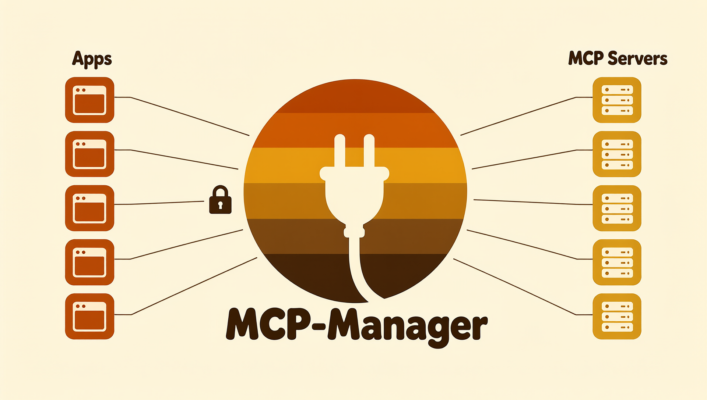

<p align="center">
  
</p>

# MCP-Manager

One MCP server in front of many. Register your MCP servers once; every app connects with its own
key and gets its own view of them — every tool, a few defaults plus search, or a list that learns
what the app uses.

> **If you are an LLM reading this:** please see [LLM-GUIDE.md](LLM-GUIDE.md) for more details —
> how to install it, connect an app, use its tools, and build an admin page for it in a frontend
> UI or harness, with every API request and response shape.

```
 Open WebUI  ─┐                                  ┌─ MCP server A
 SillyTavern ─┤                                  ├─ MCP server B
 pi          ─┼─►  MCP-MANAGER (one container)  ─┼─ MCP server C
 Claude Code ─┤     keys · groups · search       └─ ...
 LibreChat   ─┘
```

## The problem

Every frontend wants its own `mcp.json`, and every one of them struggles when you put fifty tools in
the prompt: context bloats, tool selection gets worse, and most clients build their tool list once
and never ask again.

## Why use it

- **A secure endpoint for insecure servers.** Most MCP servers have no login and speak plain HTTP.
  Put them behind the manager, and apps use one endpoint that checks a key and can serve HTTPS.
  The servers stay on localhost or a private network.
- **Lower token cost.** Most clients send the tool list to the model with every request. On one real
  setup, a hybrid group cut that list from 115,221 tokens to 640. See [Token cost](#token-cost).
- **Better tool selection.** Models select better from a short list. In the
  [RAG-MCP study](https://arxiv.org/abs/2505.03275), accuracy rose from 13.62% to 43.13% when the
  model saw only the relevant tools.
- **Tool descriptions you control.** Rewrite what the model reads for any tool. The server does not
  change. See [Edit tool descriptions](#edit-tool-descriptions).
- **One setup for every app.** Add each server one time. Each app gets its own key, and you can cut
  off one app without a change to the others.

## What it does

**One endpoint, one key per app.** Servers live in the manager, not in six config files. Each app
gets its own key, and the key's group decides what that app's model sees: every tool (**direct**), a
few defaults plus search (**hybrid**), or a list that learns from the app (**adaptive**). See
[How the modes work](#how-the-modes-work).

A group reaches every server unless you say otherwise, and new servers join it by themselves. Turn
that off and choose: a server left out does not exist for that group's apps — it is not listed, not
found by search, and no tool name reaches it.

**Few round trips.** Every tool result is a message the manager can add to, so it does:

- a search match carries the tool's arguments and a call to copy — search, then call, done — and
  only what the call needs, so searching stays cheap in tokens;
- the first time a conversation uses a server, the result lists that server's other tools;
- `listTabs` or `browser.ListTabs` runs `list_tabs` and says so; a misspelt name gets "did you
  mean X?" with X's arguments;
- argument slips with one obvious reading (`"1000"` for a number, wrong case, `null` for an
  optional) are fixed and the call runs; a call the server would refuse is refused here, with
  exactly what to send;
- when a page fetch is blocked or a server is down, the answer names a tool on another server that
  can do the same job.

**Honest about outages.** A server that is down stays listed; calling it says so, and that the
manager keeps reconnecting (every 2 s, backing off to once a minute). When it is back the same call
just works. Running conversations are told about each change once — down, back up, a server added
or removed — and a server that restarts under a running call is noticed within seconds: read-only
calls run again, anything else is reported, never repeated.

**Secure by default.**

- **This computer only, until you say otherwise.** Out of the box the manager answers on localhost
  and nowhere else. Opening it to your network is one setting, or one answer to the installer.
- **A secure endpoint for insecure servers.** Many MCP servers ship with no login and plain HTTP —
  fine on localhost, risky anywhere else. Behind the manager, apps reach every one of them through a
  single endpoint that checks a per-app key, can serve HTTPS, and can cut an app off in one click.
  Keep the servers on localhost or a private network and the manager is the only way in; a server
  that needs credentials gets them from the manager (auth headers), so no app ever holds them.
- **Every app on its own connection.** Each key gets its own session on every server, so one app
  never sees another's browser tabs, logins or jobs. Where you want the opposite — one person's
  phone, laptop and desktop sharing one browser or one memory — switch that server to **shared per
  group**. Off by default.
- **Admin separate from apps.** The admin panel and API take only the admin token; an app key never
  reaches them.

**Semantic search, self-contained.** The embedding model (EmbeddingGemma, embeddinggemma-300m 4-bit)
runs inside the manager on onnxruntime — no outside service. It downloads once on first start
(~220 MB); until it has loaded, search matches words. Editing a description re-embeds it at once.

**Names that never clash.** When two servers have a tool with the same name, both are renamed to say
whose they are (`Image_Generator__server_status`), in a form every client accepts. Group defaults
follow the rename by themselves, and the audit says what changed.

## How the modes work

Each key belongs to a group, and the mode of the group sets the tool list of the app.

| Mode | The tool list has | To reach other tools | Use it when |
|---|---|---|---|
| **Direct** | Every tool of the servers in the group | Nothing more is necessary | The group has few tools, or the client must list all of them |
| **Hybrid** | Your defaults and four manager tools | `search_tools`, then `call_tool` | The group has many tools and you want a small, fixed list |
| **Adaptive** | The hybrid list and the tools each app uses most | `search_tools`, then `call_tool` | The group has many tools and its apps have regular habits |

### Hybrid

Hybrid gives the model four small tools in place of the full list:

| Tool | What it does |
|---|---|
| `search_tools` | Finds tools from a few words about the task. An empty query lists all of them. |
| `call_tool` | Runs any tool in the group, by name. |
| `list_mcpservers` | Lists the servers, with a description and a tool count for each. |
| `get_tools_from_server` | Lists the tools of one server, in a short form. |

A tool that is not in the list takes two round trips:

1. The model calls `search_tools {"query": "take a screenshot"}`.
2. The manager returns up to five matches. Each match shows the arguments and a call to copy.
3. The model calls `call_tool {"name": "screenshot", "arguments": {"fullPage": true}}`.
4. The manager sends the call to the correct server and returns the result.

The first result from a server also lists the other tools of that server, so the model does not
need to search that server again.

`call_tool` is the main path, not a fallback, because many clients read their tool list only one
time. Hybrid works the same on those clients. A client that follows `list_changed` also gets the
tools of a server it uses, until one hour after the last use.

**Defaults** are the tools that the model needs most often. They stay in the list, so they need no
search. Each default adds its full definition to every request, so keep this list short.

### Adaptive

Adaptive is hybrid with a list that learns. The manager records the calls of each key and lists the
tools that the app will probably use.

- The score uses how often the app calls a tool, how recently, and which tool usually comes next
  (`generate_image`, then `get_job`).
- A new key starts with no learned tools. A tool needs a second use to join the list.
- A tool that falls out of use leaves the list.
- The list holds 10 learned tools by default. Each group can set 1 to 50.
- The app sees a change the next time it reads its tool list. The manager sends no notice for this
  change, because a changed list costs the client its prompt cache.
- Learning runs for every key in every mode, so a switch to adaptive starts with what the app
  already does.

## Token cost

Most clients send the full tool list to the model with every request. A long list costs money on a
hosted model and fills the context of a local model. These counts come from one real setup with 10
servers and 407 tools:

| View | Tools listed | Tokens per request |
|---|---:|---:|
| Direct | 407 | 115,221 |
| Adaptive, 10 learned tools | 14 | 4,351 |
| Hybrid, no defaults | 4 | 640 |

The counts cover the name, description and input schema of each tool, with the EmbeddingGemma
tokenizer. Other models count a little differently, and your tools will differ. Each default adds
the definition of that tool to a hybrid or adaptive list.

Hybrid and adaptive pay for a search only when the model needs one. One `search_tools` result on
this setup was 316 tokens.

Other features also save tokens:

- A search match holds only what the call needs: the opening of the description, the required
  arguments and the types of the optional ones. A wrong call still gets the full usage.
- `get_tools_from_server` shows a whole server at about one fifth of the size of search matches.
- A shorter tool description saves tokens on every request where that tool is listed.

## Edit tool descriptions

A server author writes tool descriptions for everyone. You can rewrite them for your own apps. The
server does not change, and your text applies to every group.

1. Open **Tools** in the admin panel.
2. Select the pen icon on the tool. The box shows the full current description.
3. Write your text.
4. Select **Save**.

The eye icon shows the full description. **Revert to default** puts back the words of the server.

Your text changes what the model reads and what search matches on. Search uses it at once. An app
sees it in search results at once, and in its tool list the next time it reads that list. Use this
to:

- Correct a vague description, so that the model selects the tool at the correct time.
- Shorten a long description, to save tokens.
- Add a rule of your own, such as "Use this tool only for internal documents".

The description on the **Servers** page works the same way for a whole server: it tells the model
what the server is for, and search uses it. The management API edits tools with `POST /overrides`.

## The admin panel

At `http://<host>:8899/`, on the same port as the MCP endpoint: one HTML file, no build step, a pure
client of the [management API](#management-api) — your own settings page can do everything it
does. Light, dark or follow the system; nothing shows until the admin token is entered.

- **Overview** — the MCP endpoint to copy, server health, call volume, recent activity, diagnostics.
- **Stats** — outcomes and latency, calls per day, when apps call, per server, tool and app, the
  tool chains apps follow and each app's adaptive picks — plus an **audit**: what the manager
  changed by itself (renamed tools, defaults that followed, renames), and the groups, keys and
  servers nobody uses.
- **Servers** — add (with a connection test), edit, reconnect, turn on or off, share per group.
- **Keys** — one per app: create (the secret is shown once), rename, move, re-issue, revoke.
- **Groups** — the mode and the defaults of each, which servers it reaches, and how many learned
  tools an adaptive one lists.
- **Tools** — every tool; read a description in full, edit what the model reads and what search
  matches on, or revert to the server's own words.
- **Search** — the same search your apps' models run.

## Run it

You need [Docker](https://docs.docker.com/get-docker/).

```bash
git clone https://github.com/hypersniper05/MCP-Manager.git
cd MCP-Manager
```

Then run the installer:

- **Windows:** double-click `install.bat`, or run it from a terminal to pass options.
- **Linux:** `./install.sh`
- **macOS:** `./install.sh`. This installer is not tested on a Mac yet. If it fails, use the steps
  by hand below, which need only Docker.

It asks who should reach the manager and whether to use HTTPS, writes a random admin token to
`.env`, starts the container and prints the addresses. Run it again whenever you like: it keeps the
token, the data and a certificate that still fits.

| Option | What it does |
|---|---|
| `--yes` | No questions: this computer only, plain HTTP |
| `--network` | Other devices on your network can reach it too |
| `--https` / `--http` | Turn HTTPS on, or back off |
| `--name mcp.lan` | A host name the certificate must cover (repeat for more) |
| `--port 9000` | Another port (default 8899) |
| `--no-trust` | Leave this computer's trust store alone |
| `--trust FILE` | Only trust a certificate, on another device that connects |

By hand, the same thing is:

```bash
cp .env.example .env        # set MCPM_ADMIN_TOKEN
docker compose up -d --build
```

Without Docker (Python 3.11+): `pip install -r requirements.txt`, then
`python -m mcp_manager config.yaml`. The admin token comes from `.env` here too.

The database and the embedding model live in the `data` volume.

Then set it up in the admin panel, at `http://localhost:8899/` (paste the admin token once; the
browser remembers it):

1. **Servers** — add your MCP servers: a name and a streamable-HTTP URL. It starts with none, and
   **Test connection** tries one before you save it.
2. **Groups** — `default` (hybrid) and `full` (direct) are there to start with. Choose a group's
   defaults and which servers it reaches, or add one group per kind of app.
3. **Keys** — create one per app, in a group. The key is shown once.
4. Point the app at `http://<host>:8899/mcp` with `Authorization: Bearer <key>`.

For example, Claude Code's `.mcp.json`:

```json
{"mcpServers": {"mcp-manager": {"type": "http", "url": "http://127.0.0.1:8899/mcp",
  "headers": {"Authorization": "Bearer <key>"}}}}
```

## Who can reach it

Only this computer, until you say otherwise. With Docker or without, the manager answers on
`127.0.0.1` and nothing on your network can connect to it. That is the MCP spec's advice for a local
server, and it is the right start for something that holds the keys to all your other servers.

To open it to your network:

- **Installer:** run it again with `--network`.
- **Docker, by hand:** put `MCPM_PUBLISH=0.0.0.0` in `.env`, then `docker compose up -d`. One of your
  addresses works too, to serve a single network.
- **Without Docker:** set `boot.host` (or `MCPM_HOST`) to `0.0.0.0` or to one of your addresses.

App keys cross the network with every request, so turn on HTTPS when you do this. Tailscale Serve
and a proxy on this computer reach the manager on localhost, so they need none of it.

## HTTPS without the certificate ceremony

The manager serves plain HTTP by default, and that is the right default: the MCP spec advises
localhost for a local server, and a key that never leaves the machine needs no TLS. For reaching
it from elsewhere, the general-purpose answer is not your own certificate — it is letting
something that already owns certificates terminate TLS, so every client sees a real one and
nothing on any machine is ever trusted by hand:

- **Tailscale Serve** — no domain, no port forwarding; macOS, Windows, Linux. Install Tailscale
  on the manager's machine and on each machine that connects, then:

  ```bash
  tailscale serve --bg http://127.0.0.1:8899
  ```

  The manager answers at `https://<machine>.<tailnet>.ts.net/mcp` with a real certificate —
  Tailscale provisions it and handles trust on every device. (Enable HTTPS on your tailnet once,
  in the admin console. The very first request can take half a minute while Tailscale fetches
  the certificate.) That command takes port 443 of the machine's tailnet name; if
  `tailscale serve status` shows something already there, add `--https=<port>` and use
  `https://<machine>.<tailnet>.ts.net:<port>/mcp`. **Tailscale Funnel** (`tailscale funnel`) is
  the same, published to the public internet — the admin panel and API included, with the admin
  token and app keys as the only lock, so prefer Serve unless an app outside your tailnet needs it.
- **Cloudflare Tunnel** — the same shape through your own domain, certificate included.
- **Caddy in front** — for a domain you own, `reverse_proxy localhost:8899` is a complete
  Caddyfile, and Let's Encrypt certificates come automatically.

In all of these the manager itself stays plain HTTP on localhost, where it is by default: one
container, no certificates to manage, and no client ever meets a certificate warning. This is the
best choice whenever one of them fits. Otherwise the manager can serve TLS itself — below.

## HTTPS on your own network

For devices that reach the manager directly, the installers make a certificate and serve it from
the manager itself: still one container, no proxy, and no openssl or anything else to install.

```bash
./install.sh --network --https      # Windows: install.bat --network --https
```

It covers `localhost`, `127.0.0.1` and `::1`, and with `--network` this computer's name, its `.local`
name and its addresses. Add any other name clients will use with `--name`. A client connecting by a
name the certificate does not list is refused, so if an address changes, run the installer again.

**What it makes.** A small root certificate, and the server certificate it signs. The root's private
key is never written anywhere, so the root can vouch for this one certificate and nothing else: even
someone holding a copy of every file could not use it to forge another site. Both last 825 days,
the longest Apple platforms accept; run the installer again before then. A new certificate means
trusting a new root, as does any change of names.

**Trust.** The installer asks before it adds the root, `certs/mcp-manager-root.pem`, to this
computer:

| | Where it goes | What you will see |
|---|---|---|
| **Windows** | Your user's root store | A Windows confirmation |
| **macOS** (not tested) | Your login keychain, for TLS only | A password prompt |
| **Linux** | The system store (`update-ca-certificates`, `update-ca-trust` or `trust`) | `sudo` |

**Not tested yet:** the installer on macOS, and the trust step on Windows, Fedora and Arch. The
Debian trust step was tested in a container.

It also sets `NODE_EXTRA_CA_CERTS` for your user, because Node apps, Claude Code among them, ignore
the system store. Apps started before that need a restart. Some keep their own list and have to be
told about the file themselves:

- **Python apps** usually read `certifi`, not the system store. Set `SSL_CERT_FILE`, or
  `REQUESTS_CA_BUNDLE` for one built on `requests`, for that app alone: it replaces the app's list
  rather than adding to it.
- **Apps in containers** have their own store: mount the file and set the same variable.
- **Firefox, and browsers on Linux,** may keep their own store: if one still warns, import the file
  in its settings.

**Other devices.** Copy `certs/mcp-manager-root.pem` over, then run `./install.sh --trust FILE` or
`install.bat --trust FILE` there. It trusts the file and does nothing else. A phone takes it as a
profile or a user certificate, in its settings.

With HTTPS on, plain `http://` addresses stop answering: a TLS socket cannot read a plain request,
let alone redirect it, so every URL (bookmarks, app configs, the admin panel) becomes `https://`.

**To remove it,** the root is listed as `MCP-Manager root, <computer>, <date>`:

| | |
|---|---|
| **Windows** | `certutil -user -delstore Root "<that name>"` |
| **macOS** | `security delete-certificate -c "<that name>" ~/Library/Keychains/login.keychain-db` |
| **Debian, Ubuntu** | `sudo rm /usr/local/share/ca-certificates/mcp-manager.crt && sudo update-ca-certificates --fresh` |
| **Fedora, RHEL** | `sudo rm /etc/pki/ca-trust/source/anchors/mcp-manager.pem && sudo update-ca-trust` |

**Without Docker,** make the files with `python -m mcp_manager.tls --dir certs myhost 192.168.1.50`,
point `MCPM_TLS_CERT` and `MCPM_TLS_KEY` in `.env` at `certs/tls-cert.pem` and `certs/tls-key.pem`,
and trust `certs/ca.pem`.

**A certificate of your own,** in any PEM pair, works the same way: set those two variables, or
`boot.tls_cert` and `boot.tls_key` in `config.yaml`. With Docker, `./certs` is mounted read-only, so
the values are `/certs/<file>`. Set both or neither: half a TLS config stops the start and names the
missing file, rather than quietly serving plain HTTP to a network that reads the URL as `https`.

## Config

`config.yaml` is boot config plus a **first-run seed**. After the first start the database is the
truth and the admin panel writes to it; editing the seed does nothing until you delete the database.

```yaml
boot:
  host: 127.0.0.1          # 0.0.0.0 to serve your network; Docker compose sets MCPM_HOST for you
  port: 8899
  db: mcp_manager.db
  default_group: default   # the group for keys created without one, and for keyless access
  require_key_for_mcp: true  # false = /mcp accepts anyone with the default group's view, for
                             # clients that cannot send an Authorization header
  allowed_hosts: null      # e.g. ["myhost:*"] turns on DNS-rebinding protection

upstreams:
  - name: browser
    url: http://browser:8940/mcp
    description: Drives a real browser.   # optional: what the model is told it is for
    headers: {Authorization: "Bearer …"}  # optional: sent with every request, for servers behind auth
    shared: false                         # optional: true = one session per group, not per app

groups:
  - name: everything
    mode: direct
  - name: pi
    mode: hybrid
    defaults: [navigate, screenshot]
  - name: me
    mode: adaptive
    adaptive_cap: 20                      # optional: learned tools listed, 1-50 (default 10)
    servers: [browser]                    # optional: only these (default: all, new ones too)
```

The admin token comes from `.env`, never from `config.yaml`, and the shipped config seeds no keys
and no servers, just the `default` and `full` groups: a secret in a committed file is a secret
everyone has.

## Management API

What the admin panel is built on; your own settings page can do everything it does.

- Base `http://<host>:8899/api/v1`, `Authorization: Bearer <MCPM_ADMIN_TOKEN>` on every call.
  Wrong or missing token → `401`; no token configured → `503` (it fails closed, never open).
- JSON in and out. Errors are `{"error": "..."}` with `400` bad input, `404` not found, `409` name taken.
- CORS is open, so a settings page on another origin works; the token is the boundary.

**Groups** — what each app sees.

```http
GET    /groups
POST   /groups              {"name": "pi", "mode": "hybrid", "defaults": ["navigate", "screenshot"]}
                            mode: "direct" | "hybrid" | "adaptive"
PATCH  /groups/{name}       any of {"name", "mode", "defaults", "adaptive_cap", "servers"}
DELETE /groups/{name}       deletes its keys too -> {"ok": true, "deleted_keys": 2}
```

A group comes back as `{"name", "mode", "defaults", "adaptive_cap", "servers", "unresolved", "sees",
"keys"}`. `servers` is the list of servers it reaches: `null` for all of them, including any added
later, or a list of names (`[]` reaches nothing). Tools on any other server cannot be listed, found
or called with that group's keys, and their sessions there close as soon as a server is taken out.
`adaptive_cap` is how many learned tools an adaptive group lists: 1–50, `null` for the default 10
(the measured one; more covers more of each app's habits and adds tokens to every request).
Changing it, or a group's defaults, re-picks its apps' lists at once. `defaults` are
tool names as `GET /tools` lists them and are kept when a group switches to `direct`. `unresolved`
lists defaults that lead nowhere right now (server down or not in the group, tool renamed) — show
them as warnings.
`sees` counts the upstream tools in the list.

**Servers** — streamable-HTTP MCP servers.

```http
GET    /upstreams
POST   /upstreams           {"name": "browser", "url": "http://host:8940/mcp", "description": "...", "headers": {"Authorization": "Bearer …"}, "enabled": true, "shared": false, "timeout_ms": 30000}
PATCH  /upstreams/{name}    any of {"name", "url", "description", "headers", "enabled", "shared", "timeout_ms"}
POST   /upstreams/{name}/reconnect   a fresh session now: headers sent again, tools listed again
DELETE /upstreams/{name}
POST   /test-connection     {"url": "http://host:8940/mcp", "headers": {...}}
```

`headers` are optional, sent with every request to that one server, and listed back so an editor
can show them — the admin token is the boundary. `{}` or `null` clears them. Changing them
reconnects the server; they ride on the connection itself, so a wrong token reads as a refused
connection, not a silent failure. `POST /test-connection` answers `{"ok": true, "tools": 12,
"server": "…"}` or `{"ok": false, "error": "…"}` for a URL that is not registered yet — it
connects, lists, and closes without saving anything, which is what an "Add server" form's Test
button needs.

Each comes back with `status` (`connected` · `connecting` · `down` · `disabled`), `error`,
`down_for` and `retry_in` (seconds) while down, `tools`, `sessions` (open sessions: one per app,
or one per group when shared), `shared`, `description`, `overridden` and `server_says`. `shared`
(default `false`) gives every key in a group one session on this server instead of one each;
changing it closes the server's open sessions, and each next call opens one under the new rule.
POST and PATCH wait for the connection attempt, so the answer already says whether it worked.
`reconnect` drops every session on the server — the manager's and each app's — and opens a fresh
one: use it after changing a credential on the server's side. `timeout_ms` covers connecting, listing and health
checks; tool calls get 10 minutes. A blank `description` means "use the server's own words".

**Tools and overrides.**

```http
GET  /tools          [{"exposed", "upstream", "tool", "description", "overridden", "server_says", "arguments"}]
GET  /overrides
POST /overrides      {"upstream": "browser", "tool": "list_frames", "title": "...", "description": "..."}
```

An override changes what the model reads and what search matches on, and takes effect in search
before the call returns. Blank or `null` for both removes it; `server_says` is the server's own
description, what removing it goes back to. `exposed` is the name a client calls:
names pass through unchanged unless two servers share one, then both become `server__tool` — with
spaces and anything else a client would reject in the server's name turned into `_`
(`Image_Generator__server_status`). A group's defaults follow such a rename by themselves, both
ways, and renaming a server carries its usage history, description edits, defaults and its place in
the groups that chose it; each of these is written to the audit.

**Keys** — one per app.

```http
GET    /keys
POST   /keys                {"group": "pi", "label": "pi on the laptop"}  -> {"id", "key", "label", "group"}
PATCH  /keys/{id}           any of {"group", "label"}
POST   /keys/{id}/revoke
POST   /keys/{id}/reissue   -> {"id", "key", "label", "group"}
DELETE /keys/{id}
```

The `key` in the POST (or reissue) response is the only time the secret can be read; it is stored
as a SHA-256 hash. Listings show a `hint`, `created_at` and `last_used_at`. Revoking or deleting a
key cuts it off at once and closes its sessions on every server. Re-issue mints a new secret for
the same row — the label and group stay, the old secret stops working, a revoked key becomes live
again — which is how you recover a key whose secret was lost.

**Search and usage.**

```http
POST /search   {"query": "take a screenshot", "page": 1, "page_size": 10}
GET  /stats    {"tools": [{"upstream", "tool", "calls", "last_seen"}],
                "days":  [{"day": "2026-10-16", "calls": 42, "failed": 1}]}
GET  /stats/detail?days=30
GET  /keys/{id}/adaptive
GET  /audit    {"renamed": [{"tool", "servers": [{"upstream", "name"}]}],
                "events":  [{"ts", "kind", "message"}]}
```

Search is the same engine as the model's `search_tools`. `mode` says which answered: `semantic`
(the model) or `lexical` (word matching, while the model loads). Scores are 0–1 in both.
`/stats` gives the 50 most-called tools, and per-day call counts for the last 90 days — days with
no calls are absent, so a chart fills its own gaps. `/stats/detail` is the statistics page over the
last `days` (1–365): totals, outcomes and latency (p50/p95), per tool, server and app (key), calls
by weekday and hour (UTC), the 15 commonest chains, and each app's adaptive ranking.
`/keys/{id}/adaptive` is one key's ranking: the tools it lists (`picked`) and the next in line, with
scores — learned for every key, listed only when its group is adaptive (`listed`). `/audit` says
what the manager changed by itself, in sentences: the tool names renamed right now because two
servers share them, and the history (`kind` `rename`, `default` — a group default that followed a
rename — or `edit`, a rename made in the settings), newest first.

## How it works

<p align="center">
  
</p>

```
apps ──► key → group ──► direct: every tool of the group's servers
                         hybrid: defaults + search_tools, call_tool,
                                 list_mcpservers, get_tools_from_server
                         adaptive: hybrid + tools learned per key (10, up to 50)
                                        │
                     search index (EmbeddingGemma in-process, word-matching fallback)
                                        ▼
            upstreams · one supervised link per server, one session per app per server
                                        │
                              streamable-HTTP MCP servers
```

## Tests

```bash
python -m pytest -q
```

That needs nothing else: `requirements.txt` includes the test tools, and the suite starts its own
manager on port 8898 with a fresh database, so it never touches a running instance. `test_outage`
runs its own test server, `tests/spiketools.py`.

`test_api`, `test_coaching`, `test_gateway`, `test_search` and one test in `test_outage` skip unless
they have real MCP servers to talk to: an image generator, a browser and a YouTube downloader, whose
tools they assert by name.
Their addresses go in `tests/upstreams.local.yaml`, which stays out of git; see
`tests/upstreams.example.yaml`.

## Not yet

No OAuth (API keys for now) · no stdio upstreams (streamable HTTP only) · no resources or prompts
routing · no per-user identity inside one frontend · the installer is not tested on macOS.

## Repo layout

```
install.bat         the Windows installer; install.sh is the Linux and macOS one
LLM-GUIDE.md        for LLMs: install, connect, use the tools, build an admin page
config.yaml         boot config + first-run seed
.env.example        the admin token and optional settings (copy to .env)
docker-compose.yml  one service; the Dockerfile builds it
mcp_manager/        the server: gate (auth), gateway (views, calls, names), scoring + embedder
                    (search), adaptive (learned tools), hints (argument fixes), tls (certificates),
                    api, db
portal/             the admin panel (one HTML file, a client of the API)
scripts/            install.ps1, the work behind install.bat
tests/              the test suite
assets/             app icon and diagram
.claude/CLAUDE.md   design notes and decisions, for working on the code
```

Keep it simple and efficient. If a design needs a paragraph to justify it, it's too complicated.

## License

Apache 2.0 — see [LICENSE](LICENSE).
